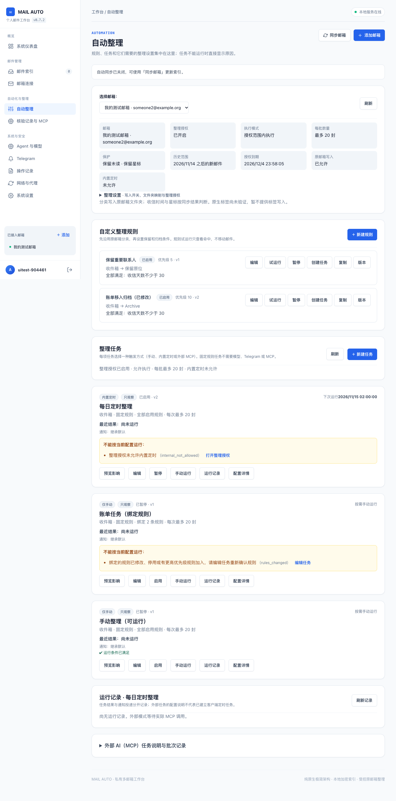
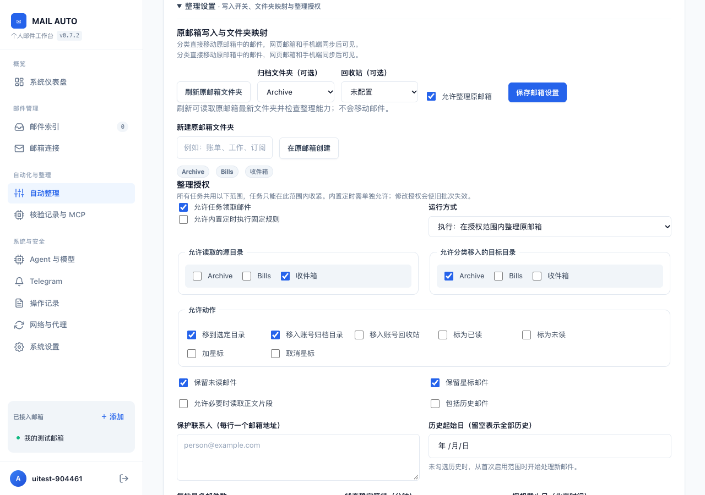
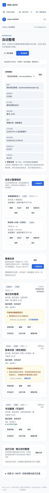
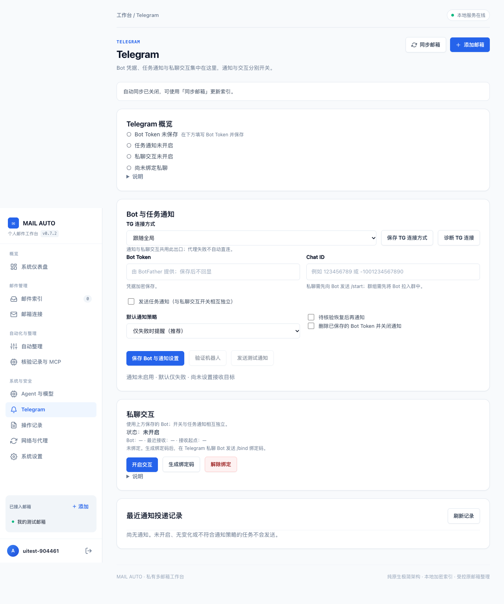
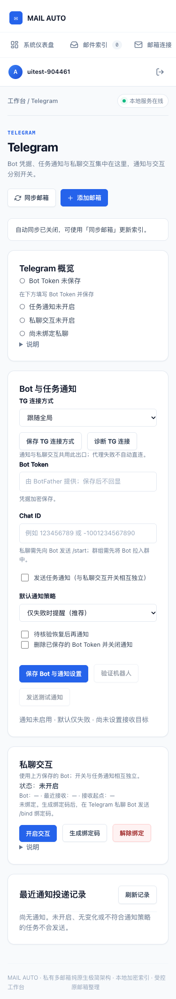
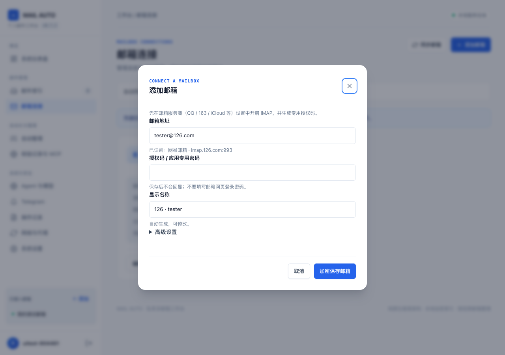
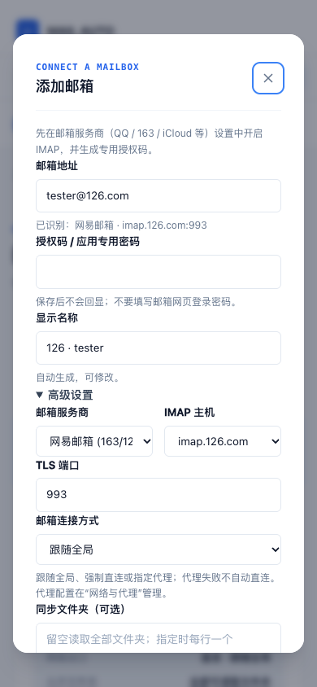

# 0.8.0 验收材料：设置减负与任务反馈

日期：2026-11-15（Asia/Shanghai）。第二阶段交付。数据库仍为 schema 13，无迁移、无新依赖、无新服务。本文件供 Codex 独立复验，不代表验收已通过。

证据类别标注：**[模拟]** 假 API / 假模型 / 本地测试实例；**[本地真实后端]** 本地临时实例的真实 Go 后端与 SQLite（测试数据）；**[生产只读]** Oracle1 只读查询；**[用户确认]** 用户口头确认，执行者无法独立复核。

## 1. 提交、版本与范围

- 版本 0.8.0；发布提交与标签 `v0.8.0` 见第 5 节；基线 `4f60b9f`（0.7.2 + 补充验证报告）。
- 本地主目录（主工作副本）已从 0.7.1 快进到 `4f60b9f`（仅 fast-forward，未触碰未跟踪的 `.planning/` 与 `AGENTS.md`）。

### 变更

| 范围 | 实现 |
| --- | --- |
| 邮箱添加 / 编辑 | 主表单只有邮箱地址、授权码、显示名称；按域名从现有白名单选择服务商与主机（qq.com、foxmail.com → imap.qq.com；163/126/yeah.net → 各自网易主机；icloud.com、me.com、mac.com → imap.mail.me.com）；名称自动生成直至用户修改。主机、端口、连接方式、指定文件夹、外部 secret 在“高级设置”，折叠时显示非默认摘要。编辑已有邮箱不自动改动任何保存值。无法识别域名时提示并阻止保存，除非在高级设置手动选择服务器。保存后定位并高亮该邮箱卡片（连接 / 同步状态与诊断入口所在处），不额外提交同步 |
| 自动整理 | 新视图 `automation`：一个邮箱选择器、设置摘要、可展开“整理设置”（写入开关、归档 / 回收站映射、整理授权）、规则区、任务区、折叠的外部 AI 区。复用原有表单、编辑器与 API（元素 ID 不变）。`showView("rules"/"tasks")` 与 `#task-run=` 链接仍可用 |
| 就绪检查 | `GET /api/tasks/readiness?account_id=` → 每个任务 `{ready, issues[{code, area, target, blocking}], last_run}`。`saveTask` 的策略检查提取为 `taskPolicyIssues`（保存仍返回第一项的原错误）；运行时检查共用 `sourceNotSynced`、`actionsAllowed`、`destinationAllowed`（`authorizedAutomation` 与 `SubmitAI` 已改为调用它们，语义不变） |
| 任务卡 | 最近结果分类：尚未运行 / 运行中 / 执行失败 / 写入待核验 / 已整理 / 观察完成 / 保护跳过 / 需外部 AI / 保留原位 / 没有可处理的邮件；不能分类时“结果未知，服务器没有提供可细分的原因”。缺项中文说明 + 错误码 + “打开整理授权 / 打开文件夹映射 / 编辑邮箱 / 编辑任务”按钮；到运行记录与核验记录的链接 |
| 规则 → 任务 | 规则“创建任务”：预填邮箱、授权内的源目录、该规则及同源且优先级不低于它的启用规则绑定；暂停观察任务，用户检查后保存 |
| Telegram | 「Telegram」页面：概览、Bot 与任务通知、私聊交互（自 Agent 页移入）、投递记录；长说明在“说明”折叠区。通知与交互两个开关独立；后端仅 `SaveNotifications` 写 `notification_channel`，绑定不改通知 Chat ID |
| 草稿保护 | `guardForm`：整理授权、文件夹映射、Telegram、邮箱、规则、任务编辑器。刷新不覆盖脏表单；离开页面、切换邮箱、关闭对话框（按钮 / Esc）、关闭浏览器标签时确认；保存失败保留；保存期间的新编辑不被迟到响应清掉（代际比较）。草稿与密钥只在内存，前端无 `localStorage`/`sessionStorage`/IndexedDB |
| 文案 | 旧页面名称更新；每日额度描述更正为“计数仅统计、不限制数量，跨日旧入队项拒绝写入”（与 `operations.go` 一致）；0.7.2 补充验证报告的“尚未提交”与 `pending=false` 过强表述已更正 |

### 未做 / 未完成

- 未新增模型市场、自动故障切换、持续 AI 分类、报表、向导、持久化草稿或配置修订系统；未修改模型连接。
- 新任务的“编辑器内实时就绪检查”未做：任务保存前的缺项由编辑器现有限制（选项禁用）和保存错误给出，保存后在任务卡显示服务端缺项。
- 文件夹选择仍沿用现有下拉 / 复选框。
- 保存错误文案沿用后端既有中文映射（如“当前操作未授权，或写入已停用”）；就绪检查给出更具体的原因。

## 2. 新旧入口对应与截图

| 旧入口 | 新位置 |
| --- | --- |
| 整理规则 | 自动整理 → 规则区（`#auto-rules`） |
| 整理规则 → 任务整理授权 | 自动整理 → 整理设置 → 整理授权 |
| 定时与任务 | 自动整理 → 任务区（`#auto-tasks`） |
| 整理与 MCP → 原邮箱文件夹分类 | 自动整理 → 整理设置 → 原邮箱写入与文件夹映射 |
| 整理与 MCP（核验、MCP） | 核验记录与 MCP |
| TG 通知 | Telegram → Bot 与任务通知 |
| Agent 与 TG → Telegram 私聊交互 | Telegram → 私聊交互 |
| Agent 与 TG（模型、授权、记录） | Agent 与模型 |

截图（**[本地真实后端]**，测试数据，`docs/images/0.8.0/`）：

- 自动整理（桌面）：
- 整理设置展开：
- 自动整理（390 px）：
- Telegram（桌面 / 375 px）： 
- 添加邮箱（桌面 / 高级设置 390 px）： 

## 3. 测试

| 命令 / 用例 | 结果 |
| --- | --- |
| `make check`（race 全项目、vet、gofmt、staticcheck） | 通过（3.1） |
| `go test -count=1 -race ./internal/{mail,admin,agent,modelprovider,store}/` | 通过（3.1） |
| `CGO_ENABLED=0 go build -trimpath ./cmd/mail-auto`、`git diff --check`、`docker compose config --quiet`、全部前端与检查脚本 `node --check` | 通过（3.1） |
| `mail.TestReadinessReadyTaskIsReadOnlyAndShowsLastRun` | 就绪任务无缺项；检查前后 task_runs / audits / operations / 任务与授权版本完全相同；无模型、TG、MCP 时固定规则任务真实完成移动并在 `last_run` 报告 |
| `mail.TestReadinessMatchesEnableAndRunChecks` | 六种阻塞（未允许内置定时、授权到期、目标目录被撤销、写入关闭、源目录不在同步范围、绑定规则变化）均与实际启用 / 运行结果一致：就绪检查报缺项时，启用或运行同样被拒（ErrDenied / ErrConflict），目标目录被撤销时运行失败且未写入 |
| `mail.TestTaskPolicyIssuesKeepSaveErrors` | 提取后的检查保持原错误顺序与类型 |
| `admin.TestTasksAndNotificationsHTTPBoundary`（扩展） | `/api/tasks/readiness` 路由到只读报告而非任务 ID；不写运行与审计；POST 被拒 |
| `scripts/ui-check/settings-ui-check.js` **[模拟]** | 45 项 × 1280 / 375 / 390 px 全部通过：摘要、结果分类、缺项与修复按钮、规则建任务（含高优先级绑定、停用规则拒绝）、刷新 / 离开 / 切换邮箱保护、保存失败保留、迟到响应、Telegram 概览与独立开关、Token 不预填不回传、浏览器存储为空、输出长度控件仍不存在、无横向溢出 |
| `scripts/ui-check/model-ui-check.js` **[模拟]** | 63 项 × 3 宽度全部通过（第一阶段与 MC-02/03/05 回归） |
| 运行方式 | `node scripts/ui-check/run-checks.cjs <puppeteer 路径> <实例 URL> <测试凭据 JSON> <脚本…>`：每个宽度重新加载页面后执行，汇总结果与页面错误（本次 0 个页面错误） |
| 邮箱对话框 **[本地真实后端]**（真实键入） | `tester@163.com` → 网易 / imap.163.com:993、名称“163 · tester”；未识别域名阻止保存并展开高级设置；手动选择服务器后可保存；手改名称后不再自动覆盖；保存后对话框关闭、卡片高亮显示“配置已保存 · 尚未验证连接”；编辑保留 imap.126.com 且改地址不改主机；Esc 在有修改时询问 |
| 就绪接口 **[本地真实后端]** | 三个任务：定时任务在关闭内置定时后报 `internal_not_allowed`；绑定规则修改后报 `rules_changed`；手动任务就绪；接口调用前后任务列表逐字节相同 |
| 键盘 / 布局 | 页面截图与检查脚本覆盖 1280 / 375 / 390 px |

### 3.1 命令记录

全部在本地 worktree、最终代码上执行（2026-11-15）：

- `make check`：exit 0（全项目 `go test -race`、`go vet`、gofmt、staticcheck v0.8.2 无输出）。
- `go test -count=1 -race`：mail 244 s、admin 116 s、agent 48 s、modelprovider 3 s、store 32 s，全部 ok。
- `CGO_ENABLED=0 go build -trimpath ./cmd/mail-auto`、`git diff --check`、`docker compose config --quiet`：通过。
- `node --check`：`internal/admin/web/*.js`、`scripts/ui-check/*.js`、`run-checks.cjs` 全部通过。

## 4. 升级前后配置对比方法

脚本（只读，经 SSH 标准输入执行，不在服务器落文件）比较升级前快照与升级后数据库：任务（用户字段 + 启用 / 触发 / 版本）、整理授权、规则、文件夹设置、账号（密钥只比摘要）、通知通道（密钥只比摘要）、Telegram 交互设置与绑定、网络设置、Agent 授权、模型当前配置与连接、schema。`next_run_at`、`next_times`、`last_triggered`、`cursor`、`last_state` 与检测时间单列为运行元数据。

发布前演练（**[生产只读]**，0.7.2 升级快照 vs 当前库）：22 项相同；差异仅为 0.7.2 补充验证期间已记录的模型连接变化（A 模型、B 新建、当前配置版本），与预期一致。

## 5–6. 发布、部署、备份与清理

（部署后补记）

## 7. 独立复验步骤

1. `git show v0.8.0 --stat`；`make check`。
2. 启动临时实例：`mail-auto -data-dir <tmp> -key-dir <tmp> -listen 127.0.0.1:18082 -automatic-sync=false`，用 `mail-auto bootstrap show` 的临时账号完成首次设置。
3. 运行 `run-checks.cjs` 执行 `settings-ui-check.js` 与 `model-ui-check.js`。
4. 就绪接口：在本地实例插入测试文件夹（`mailboxes`、`folder_settings`）后按第 3 节步骤建规则、授权与任务，调用 `/api/tasks/readiness` 前后比较 `/api/tasks`。
5. 生产只读：比较升级前快照与当前库（第 4 节）；查看 `/readyz`、容器镜像与重启次数、`mailboxes.synced_at`、最近 `task_runs`。
