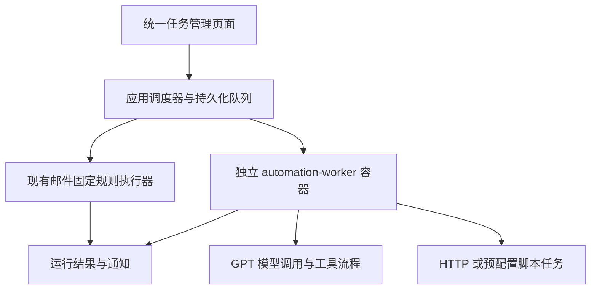

# Docker 定时任务与 GPT 任务迁移评估

评估日期：2026-10-28。依据当前工作区源码与官方文档；本轮未连接生产环境，未运行应用或重跑测试。以下扩展设计尚未实现。

## 结论

可以让该项目在 Docker 中管理定时任务，而且当前版本已经能定时运行邮件固定规则。要承接日报、GPT 分析、HTTP 调用或脚本等通用任务，还需要增加通用任务模型和执行器，不能仅修改 Compose 就完成迁移。

Docker 负责容器运行与重启，应用内调度器负责决定任务何时执行。现有 Go 调度器随 `serve` 启动，不需要再安装系统 cron。部署机器、Docker 和应用需要持续运行。

## 当前能力与边界

| 能力 | 当前状态 | 依据 |
| --- | --- | --- |
| 每小时、每天、每周触发邮件固定规则 | 已实现 | `internal/mail/tasks.go` 的 `nextSchedule` |
| 按任务时区执行，默认 Asia/Shanghai | 已实现，内嵌 tzdata | `TaskSchedule`、`SaveTask` |
| 到期任务检查 | 每 5 秒扫描，不承诺精确秒级启动 | `internal/mail/task_runner.go` |
| 日程和运行记录持久化 | SQLite，Compose 挂载数据卷 | `internal/store/tasks.go`、`compose.yaml` |
| 防止同一触发重复建轮次 | `task_id + run_key` 唯一；建轮次与推进下次时间同事务 | `createTaskRun` |
| 停机漏跑 | 恢复后合并一轮；同账号仍有活动轮次时跳过本次并推进日程 | `taskTick`、`createTaskRun` |
| 并发与执行期限 | 固定规则 worker 最多 2 轮并行，同账号最多一轮活动任务，轮次期限 10 分钟 | 调度 worker、表索引、`TaskRun.Expires` |
| 可视化启停、预览、运行记录 | 已实现 | `internal/admin/tasks.go`、`internal/admin/web/tasks.js` |
| Telegram 通知 | 已实现，独立投递队列和重试 | `internal/mail/notifications.go` |
| 由容器自主调用 GPT | 未实现 | 当前无模型 API 执行器；`SaveTask` 明确拒绝 internal + ai |
| 外部 GPT/MCP 任务 | 可接收客户端调用，不会自行唤醒模型 | `internal/mcpserver/tasks.go` |
| 任意脚本、HTTP 作业、其他容器启停 | 未实现 | 当前任务引擎仅 rules/ai，任务必须绑定邮箱与授权目录 |
| 完整 Cron、每隔数分钟、一次性任务 | 当前内置日程未提供 | 当前仅 hourly/daily/weekly |

已有自动化使用说明见 [automation-guide.md](../automation-guide.md)。例如每天凌晨 02:00 执行邮件固定规则，可在「定时与任务」中配置内置定时、daily、02:00、Asia/Shanghai。新任务会强制保存为暂停观察；完成预览、账号授权后才能启用。实际写入还受写入开关、执行授权、额度和授权有效期约束。

目前 Docker 主镜像为 distroless 静态 Go 程序，未安装脚本运行时或 cron。Compose 为应用设置 384 MiB / 1 CPU 的上限。运行 Python、Node、浏览器或较重分析任务应使用单独 worker 镜像，并单独设置资源预算。

## 建议的扩展方式

沿用现有项目的管理入口、持久化和通知思路，在同一 Docker Compose 项目下增加一个可选 worker。保留邮件固定规则现有执行链路，新增与邮箱账号无关的通用作业表、运行表及管理接口。

该图为建议架构。应用作为日程和作业状态的唯一管理入口；worker 通过经过鉴权的领取、心跳和结果上报接口工作，数据库由应用持有。每个作业只配置一个自动触发源。

建议优先支持四类执行方式：邮件固定规则、HTTP 请求、预配置脚本、GPT 工作流。常驻服务可以一直运行，到点通过内部 API 提交一次作业。若需求是到点创建或启动另一个 Docker 容器，需要另外设计容器控制接口；现有项目没有这项能力，第一阶段不必引入。

通用作业至少需要名称、类型、日程/时区、参数、启停、超时、并发策略、通知策略和执行历史。GPT 作业额外需要提示词、模型连接、数据源/工具、输出位置、调用预算及必要的持久状态。邮件任务现有的 10 分钟期限、邮箱额度和账号互斥不应直接套给全部作业。

运行机制可以借鉴现有发生键、租约、通知 outbox，但需要扩展为账号无关的接口；当前通知队列外键仍绑定邮件 task_runs，不能直接供通用作业使用。外部调用重试须区分是否已产生副作用，不能把未知结果一律重新执行。任务中断恢复也不能等同于从任意脚本中间继续运行。

邮件 AI worker 应通过受授权的 MCP 批次与计划执行流程访问邮箱，保留规则、额度、版本和写后核验，不直接读取邮箱凭据或绕过既有授权。无人值守运行还需验收客户端鉴权续期及账号授权到期后的行为。

## GPT 定时任务如何迁移

迁移单位应是“任务定义与所需依赖”。对于每个现有任务，整理以下信息：

1. 提示词与成功标准，包括哪些情况需要通知。
2. 执行时间、时区和漏跑策略；RRULE 与 Cron 的语义需核对，不能只替换字符串。
3. 输入资料、所需聊天上下文、文件、插件或 MCP 数据源。
4. 模型连接与工具权限；现有聊天中的授权和上下文不能假设容器自动具备。
5. 输出保存位置、通知渠道，以及防止同一次任务重复产生副作用的方式。

建议先迁移一个只读任务，例如每天 08:00 汇总授权邮件并保存报告。验证连续运行、通知、重启恢复、授权续期和模型失败处理后，再迁移会修改邮箱或其他系统的任务。切换时关闭旧任务对应的自动触发源，避免重复运行。

OpenAI 官方文档说明，ChatGPT 定时任务可使用聊天上下文、技能和已连接工具；项目本地任务仍依赖电脑与桌面应用可用。另有 Agents API 调度接口可创建和管理 API agent 的日程，但其日程存放在 OpenAI 服务中。若目标是日程和运行状态由本项目统一管理，可选择本地调度器触发模型调用。以上文档未建立将现有 ChatGPT 定时任务、会话与插件授权直接导出为自托管容器任务的路径，因此本方案按逐项重建任务逻辑设计，而不承诺一键搬迁。

## 实施顺序与验收

1. 增加通用作业模型和管理页面，先跑通每天一次的 HTTP / 预配置脚本任务。
2. 增加 worker 领取、心跳、取消、超时与结果上报，并接入通用通知。
3. 增加 GPT 执行器，支持模型连接、提示词、数据源、输出持久化与预算。
4. 逐个迁移现有任务；需要邮件写入的任务继续走受控邮件执行链路。

验收应覆盖北京时间触发、暂停后不新建轮次、任务重叠处理、同次重试防重复、容器重启/漏跑、长任务超时、模型限流/超时、鉴权过期、结果持久化和通知失败独立重试。宿主机整体停机时，本项目自身的通知也不可用。

本轮只完成源码级评估和文档整理。此前 0.4.0 的测试记录位于 [acceptance-0.4.0.md](acceptance-0.4.0.md)，不能代替未来通用作业/GPT worker 的实际验收，也不能据此确认今天的线上运行状态。

## 官方参考

- [Docker 容器自动启动与重启策略](https://docs.docker.com/engine/containers/start-containers-automatically/)
- [ChatGPT Scheduled tasks](https://learn.chatgpt.com/docs/automations)
- [OpenAI Agents API scheduled automations](https://developers.openai.com/api/docs/guides/agents-api/sessions/automations)
