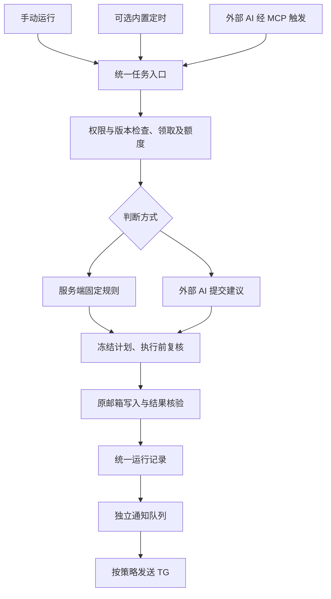

# 可选定时任务与 Telegram 通知优化计划

日期：2026-10-23。建议版本：0.4.0。状态：0.4.0 已实施；验证及发布结果见 [验收记录](acceptance-0.4.3.md)。

基线为已发布的 0.3.0：已有原邮箱文件夹整理、自定义规则、观察/执行授权、MCP 批次、计划核验、额度与审计。本轮新增任务管理、可选内置调度和 Telegram 通知，不接入模型 API。本文更新[此前规则与 AI 方案](rules-ai-mcp-automation-plan.md)关于“不另设整理调度器”的选择；当前版本行为以 [使用指南](automation-guide.md)及 [0.4.3 验收记录](acceptance-0.4.3.md)为准。

## 1. 产品目标与推荐组合

让同一套邮件整理规则既能由服务器按时执行，也能由外部 AI 通过 MCP 执行，并在需要时推送结果。用户只配置一次整理范围和保护条件，不为每种触发方式重复维护规则。

推荐按用途选择：

| 需求 | 推荐触发 | 执行方式 |
| --- | --- | --- |
| 已读订阅满 30 天归档、指定发件人分类 | 内置定时，或外部任务触发 | 服务端确定性规则，不需要 AI |
| 判断项目归属、内容重要程度、是否仍需处理 | 外部 AI/MCP | 外部 AI 判断，服务端限制与核验 |
| 临时清理、先看影响 | 手动预览或手动运行 | 复用相同任务和规则 |
| 继续沿用 GPT/Codex 的周期任务 | 外部 AI/MCP，内置定时关闭 | 外部客户端负责唤醒与调度 |

核心约定：

- 整理写回原邮箱文件夹，继续支持分类、归档、移入回收站及有条件恢复；不把本地标签当作分类结果。
- 每个任务只选择一个自动触发源；所有任务均保留手动入口。
- 内置调度只执行确定性规则，不启动外部模型。AI 在挂载 MCP 的外部环境运行。
- 无论从哪里触发，都走同一套范围、保护、额度、去重、计划、执行、核验、历史和通知。
- 默认仅手动、暂停、观察模式；TG 未配置时关闭，完成配置后的推荐策略为“仅失败”。



## 2. 先复用哪些能力

| 能力 | 0.3.0 状态 | 本次处理 |
| --- | --- | --- |
| 条件组、优先级、保留/移动/归档/回收站/AI 规则 | 已实现 | 复用，不另建规则引擎 |
| 未读、星标、联系人保护及原邮箱元数据复核 | 已实现 | 每种触发均执行 |
| 管理员授权、源/目标目录、正文权限、额度和有效期 | 已实现 | 作为所有任务的上限 |
| 外部 MCP 批次、领取租约、签名、幂等 | 已实现 | 关联通用运行记录，保留旧接口兼容 |
| 原邮箱写入、未知结果核验、停止及补偿撤销 | 已实现 | 复用操作链路 |
| 通用任务实体、固定规则独立执行入口 | 尚缺 | 本次新增 |
| 可选内置调度、漏跑与重启恢复 | 尚缺 | 本次新增 |
| TG 配置、通知策略与可靠投递 | 尚缺 | 本次新增 |

当前原生标签仍未验证。本次先沿用已确定的文件夹分类路线。标准 IMAP 通常不能读取客户端规则定义，只衔接已经同步到服务器的目录和标记结果；客户端私有标签及规则导入另行规划。

## 3. 任务配置设计

### 3.1 任务与规则分开管理

规则定义“哪些邮件做什么”，任务定义“何时执行、由谁判断、跑多少、如何通知”。首版每个任务绑定一个邮箱，可以为不同目录建立多个任务。

| 配置项 | 设计 |
| --- | --- |
| 基本信息 | 名称、邮箱、启用状态、备注 |
| 触发方式 | 仅手动 / 内置定时 / 外部 AI 或 MCP |
| 判断方式 | 固定规则 / 外部 AI；内置定时仅允许固定规则 |
| 范围 | 源目录、历史起点、允许动作和目标，均不得超过管理员授权 |
| 规则 | 首版使用账号完整的已启用规则，按现有优先级评估；运行记录保存规则版本摘要 |
| 运行模式 | 观察 / 执行；任务只能缩小管理员授权，不能将观察授权升级为执行 |
| 保护与额度 | 继承管理员保护，允许进一步收紧；默认每批 20、每日账号共享 100，上限沿用现有策略 |
| 运行边界 | 单次最多处理数量、扫描页数、最长运行时间；第一版建议最多 10 分钟，批次和计划单独受原有效期约束 |
| 通知 | 继承全局策略或单独选择策略，目标使用管理员配置的通知通道 |

首版不允许通过任务挑选部分低优先级规则来绕开高优先级保留或 AI 判断。新一轮使用当前规则；规则、策略、目录映射或任务版本在处理中变化时，未执行计划失效并重新评估。

命中 AI 规则的邮件只能交给外部 AI。若固定规则任务覆盖该类邮件，保存时提示；运行时保留该邮件并记录“需要外部 AI”，不继续套用后面的规则。已完成的固定规则部分单独计数，不把整次任务显示为全部整理完成。

### 3.2 三种触发方式

| 模式 | 页面填写 | 服务端行为 |
| --- | --- | --- |
| 仅手动 | 不要求时间 | 保存后不自动执行；用户预览或显式运行 |
| 内置定时 | 小时/每天/每周、时间、时区 | 持久保存下次时间，到时执行固定规则 |
| 外部 AI/MCP | 客户端备注、生成的任务说明；可选预期触发周期 | 等待实际 MCP 调用，不自行创建外部周期任务 |

内置定时默认时区 Asia/Shanghai，提供“未来 5 次运行时间”预览；首版使用表单预设，不要求用户写 cron。若开放其他 IANA 时区，夏令时缺失时刻跳过、重复时刻只运行一次，时间落库使用 UTC。**触发时区不改变现有账号额度按北京时间日期结算的规则。**

外部模式不强制填写服务器执行时间。可选的“预期触发周期”只用于观察是否逾期，不成为第二个执行调度器。外部客户端能否按时挂载 MCP、刷新授权、无人值守确认写入，需要在实际环境验收。

### 3.3 启停、切换和手动操作

- 新任务保存为暂停/观察，预览后再启用；启用任务也不能打开原邮箱写入开关。
- 暂停停止后续自动触发，并停止当前尚未开始的邮件动作；已完成动作保留。任务暂停后仍可预览，手动执行需要显式发起且权限有效。
- 切换触发方式递增任务版本，撤销旧模式未开始的触发，不补跑旧周期，不重置账号额度。已经开始的写入完成核验后结束本轮。
- 正在运行时再次触发，返回已有运行或“忙碌/已跳过”，不并发启动第二轮。不同任务范围重叠时通过邮件级领取和操作冲突控制。
- “取消本轮”只停止剩余动作；撤销已完成整理仍走原有预览与有条件补偿流程。
- 任务配置采用版本校验，防止网页和 MCP 同时编辑相互覆盖。

## 4. 可视化页面流程

### 4.1 页面入口

保留现有规则与 MCP 配置，将“规则与 AI 任务”逐步整理为“规则与任务”，分为规则、任务、运行记录三个页签。新增“通知设置”页，MCP 地址、检测和授权继续位于现有可视化设置中。

任务列表展示：名称、邮箱别名、触发方式、判断方式、观察/执行、启停、最近结果、下次内置运行或最近外部调用、通知策略。外部模式显示“等待外部触发/最近调用”，不显示未经验证的“GPT 定时任务已创建”。

### 4.2 新建任务向导

1. 选择邮箱和源目录，提示回收站/垃圾目录及授权边界。
2. 查看匹配规则，选择固定规则或外部 AI，识别 AI 规则和目录循环冲突。
3. 选择触发方式。内置模式填写时间；外部模式生成可复制的 MCP 任务说明。
4. 设置数量、观察/执行及通知策略，显示继承的保护条件、有效期和账号剩余额度。
5. 预览命中、跳过和待 AI 项，显示真实最终目录，保存为暂停任务。
6. 用户在页面启用；涉及实际写入时，仍要求账号写入开关及管理员执行授权已经开启。

外部任务说明包含 task_id、触发幂等键约定、批次调用顺序、额度、停止条件和结果查询方法。说明中不包含 Bot Token、邮箱密码或 OAuth 凭据。

### 4.3 运行详情

显示触发来源、任务/规则/授权版本、运行时间、扫描/领取/保留/保护跳过/待 AI/成功/失败/待核验数量、额度停止原因、相关批次与操作、通知状态。提供取消剩余项、查看计划、核验未知项及撤销预览入口。

达到数量或时间边界时显示“本轮达到限制，仍有候选”，保留扫描断点；不能显示“所有邮件已整理”。下一次触发重新验证并续扫，不自动绕过限额继续跑。

## 5. 统一运行与调度可靠性

### 5.1 所有触发共用的链路

1. 验证触发身份、任务版本、启停状态、邮箱和管理员授权；外部调用同时校验其 MCP 权限。
2. 持久创建运行记录与幂等键。相同任务、相同一次触发的重试返回原 run，不重复领取和计费。
3. 检查索引新鲜度，按有界范围同步必要元数据。同步失败记为失败；不知道最新状态时不假报“没有邮件”。
4. 取得账号执行租约及邮件级领取，应用稳定等待、保护、规则与账号共享额度。
5. 固定规则由服务端生成结构化决定；外部 AI 按现有领取/读取/提交流程提供决定，正文仍需单独授权。
6. 观察模式只记录建议；执行模式生成冻结计划，执行前复核身份、规则、授权、版本、目录和原邮箱最新元数据。
7. 通过现有操作队列写入并核验；结果不确定则进入待核验，保留冲突占用，不盲目再次移动。
8. 汇总运行结果并持久生成通知事件，交给独立通知 worker。

内置任务使用专门的受限、可撤销服务身份，范围由任务与管理员策略共同确定。当前 Access 以管理员/MCP token 为基础，因此需要补身份解析和检查；不能简单调用无限制 AdminAccess 代跑。

任务手动运行也遵循自动化额度；普通逐封手动操作继续保持原权限语义，但必须接入共同的在途冲突检查，不能与后台任务同时操作同一封邮件。

### 5.2 运行状态与通知状态分离

建议执行状态：等待、运行中、等待外部 AI、观察完成、完成、无变更、部分完成、失败、待核验、已取消、中断。额度/时间用尽作为独立停止原因，配合 `has_more`，不伪装成处理全部历史。

建议通知状态：未启用、无需通知、待发送、重试中、已发送、投递失败。邮件任务成功而 TG 失败时，任务仍为成功，通知标记失败。

长任务分批推进，每个批次重新领取和验证；不延长旧的 15 分钟领取租约或 10 分钟冻结计划来规避过期。跨北京时间日期的旧队列项按原逻辑拒绝写入，新一轮重新评估。

### 5.3 内置调度行为

- 使用数据库保存 `next_run_at`，以短周期扫描到期任务，不为每项任务启动常驻计时线程。
- `(task_id, task_version, scheduled_at)` 建唯一约束；到期记录与下一次时间推进在同一事务完成，重启后不重复创建。
- worker 使用数据库租约、心跳和带代次的占用校验；丢失租约的旧 worker 不能继续领取或开始新的写入。进程内锁不足以替代持久占用。
- 账号内任务串行执行，同一账号同步与写入复用现有协调；跨账号采用小规模受限并发，避免服务器/邮箱限流。
- 宕机漏掉多个周期，恢复后最多合并执行一次当前有效周期，并记录漏跑数量，不补发大量历史运行或通知。
- 重启发现未完成操作先核验原邮箱结果；能安全恢复的继续，未知项维持待核验。不能把整个 run 从头再次写入。
- 默认仍是单实例 SQLite 部署。租约与唯一约束保护同一数据库内重复 worker，不等于支持多台服务器各用独立数据副本运行。
- 外部 AI 运行超时后标记中断；未开始项释放领取，已入队/待核验项保留保护。迟到提交须重新检查租约和版本，过期则拒绝。

外部“从未触发”的故障只有设置预期周期后才能发现。项目可提示或通知逾期，但不会自动唤醒 GPT；整台服务器停止时，内置 TG 通知也无法发送，需要独立可用性监控才能覆盖。

## 6. MCP 接口优化

以下均为拟新增接口，实施时固定最终 schema，并保留现有 0.3.0 工具。

| 拟议工具 | 用途与限制 |
| --- | --- |
| `mail_task_list` / `mail_task_get` | 查看授权范围任务、状态、配置版本及允许的执行方式 |
| `mail_task_upsert` | 创建/修改任务，需要新增 `task_manage` 权限和预期版本；默认暂停，不能扩大管理员授权 |
| `mail_task_set_enabled` | 在既有范围内启停任务；不能提高正文、写入或动作权限 |
| `mail_task_preview` | 无写入地模拟任务，应用任务保护/范围；返回未知字段、待 AI 项和索引时间 |
| `mail_task_run` | 显式触发；传 task_id、run_key、预期版本，固定规则由服务端执行，AI 模式建立运行并返回批次交接信息 |
| `mail_task_run_get` / `mail_task_runs` | 查询共同运行记录、批次、操作及脱敏通知状态 |
| `mail_task_cancel` | 停止本轮未开始项，不自动回滚已完成动作 |

调用身份需同时具备 read、automation 及任务授权范围；task_manage 只负责配置，不代替执行权限。修改触发为内置定时还须管理员在网页预先允许本地调度及对应服务身份范围，普通 MCP 配置权限不能创建长期越权执行。

`mail_task_run` 不接受任意正文指令作为权限来源，也不接受临时扩大目录、数量或改变收件目标。外部触发只能运行对应模式的任务；内置任务仍可由用户手动调用，调用来源如实记录。

外部固定规则路径：`mail_task_run` → `mail_task_run_get`；服务端内部继续生成、保存并检查冻结计划，避免让 AI 重复转述确定性动作。观察模式保持无写入，执行模式必须具有既有管理员授权。

外部 AI 路径：创建 run → `mail_ai_claim` → `mail_ai_batch` / 按需 `mail_ai_get` → `mail_ai_submit_decisions` → `mail_plan` → `mail_ai_execute` → 查询共同 run 与 operation。批次新增受校验的 run_id 关联；后续扫描页使用派生幂等键，领取和计划依然分别过期。

外部客户端为每次周期生成稳定 run_key，同一次失败重试复用该键；服务端在任务范围内统一去重，同时仍检查调用者权限。不同客户端使用不同键时，账号/邮件领取继续防止重复写入；不能声称能自动识别任意两个客户端是否属于同一次周期。

旧工具和没有 task_id 的旧批次继续工作，可在运行页标为“旧版独立批次”，不自动替用户建立或启用任务。现有 MCP 文案中“仅外部调度”等描述应随新能力更新，`mail_automation_policy` 返回实际可用触发能力。

TG 凭据、Chat ID 和通知通道管理只开放管理员网页；MCP 只读脱敏投递状态，可在管理员既定通道上选择通知策略。AI 不得指定任意通知地址或 URL。

## 7. Telegram 通知

### 7.1 配置流程

在“通知设置”中填写 Bot Token 和 Chat ID，先验证机器人身份，再由用户点击“发送测试通知”。页面给出获取 Bot/Chat ID 的步骤及错误提示。保存配置不自动发消息，测试发送明确显示接收目标。

首版支持一个全局 Telegram 通道，任务可继承或覆盖通知策略，减少重复录入。Bot Token 复用现有凭据加密存储，读取只返回已配置/掩码；编辑留空保留、删除需明确操作。HTTPS 请求日志、错误、审计、导出和 MCP 返回都不得包含 Token；尤其要脱敏包含 Token 的 Bot API 请求路径。

仅做服务器出站推送，不要求新增 webhook、端口映射或公开接收接口。第一版不通过机器人命令操作邮箱。Chat ID 校验允许常见的负数群组标识，按字符串处理；默认固定 Telegram API 地址，不提供任意自定义推送 URL。

### 7.2 通知策略

| 策略 | 推送时机 | 适用场景 |
| --- | --- | --- |
| 关闭 | 不推送 | 只看管理页面 |
| 仅失败，推荐 | 失败、部分失败、待核验、非用户取消的超时中断 | 日常安静运行 |
| 有实际变更 | 已核验的邮件变更及上述异常 | 希望确认整理成果 |
| 每次结束 | 每次运行的汇总，包括观察/无变更/取消及异常 | 初期调试 |

规则保护跳过、没有匹配邮件、正常额度/时间边界停止、主动取消不算失败。授权过期、目录失效等阻断运行属于配置故障；仅失败模式首次提醒，相同故障在冷却期内合并。等待 AI 不立即当作故障，超过运行期限才提示中断。若部分邮件因需要 AI 未处理，页面突出显示，不能归为已全部成功。

“每次结束”以一次 run 为单位汇总，不逐封、逐批推送。待核验先发异常提示，后续核验结论单独记录；是否发送恢复提醒使用独立开关，默认关闭。正常无变化不推送；同任务、同错误码建议 6 小时冷却，不同新故障可即时提醒。

示例：

```text
Mail Auto · 任务部分失败
任务：订阅邮件归档
来源：内置定时
已核验归档 18，失败 1，待核验 1，保护跳过 4
错误：provider_timeout
时间：2026-10-23 02:00（Asia/Shanghai）
详情：已配置管理站点的运行记录链接
```

默认不推送邮件正文、主题、发件人和邮箱地址，只用任务/账号别名、数量和规范错误码。错误摘要也需脱敏。详情链接基于管理员配置的公开地址，仍须登录，不附凭据；未配置公开地址时省略链接。

### 7.3 投递与重试

- 运行状态更新与通知 outbox 事件在同一事务保存；通知 worker 异步发送，失败不阻塞邮件执行。
- 事件按运行、事件类型和状态版本去重；投递失败只重试 outbox，不重新执行邮件任务。
- 网络故障与临时错误指数退避，限流尊重 Retry-After；明确无效参数、凭据失效、无访问权限停止无意义重试，并在网页显示修复入口。
- 建议网络超时 10 秒，最多 5 次/24 小时重试，设置发送速率；最终参数通过模拟限流验收后固定。
- TG 响应丢失时，重发可能造成重复消息；保留事件标识便于识别，不承诺跨网络严格一次投递。
- 用户关闭通道或策略后，尚未发送的事件不再发送；更换接收目标时不把旧积压消息自动发送给新目标，按通道版本作废或由管理员明确重发。
- 通道不可用时在网页提示，不尝试通过同一失效通道反复通知“通知失败”。

每日摘要、安静时段、跨任务告警合并、多接收目标和自动恢复提醒可放到后续版本；首版先交付完整的失败通知与抑制重复提醒。

## 8. 数据和代码调整

建议一次业务迁移 schema 6 → 7，名称与字段在实施时最终确认：

| 数据 | 主要内容 |
| --- | --- |
| `automation_tasks` | 账号、任务配置/版本、触发与判断方式、启停、next_run_at、通知策略 |
| `automation_task_runs` | 任务/规则/授权快照摘要、来源、run_key、scheduled_at、租约、状态、计数、断点和停止原因 |
| `automation_run_batches` | run 与原有批次/操作的关联，兼容旧独立批次 |
| 统一占用与身份记录 | 任务服务身份及撤销版本、账号 worker 租约；扩展现有邮件领取以覆盖全部触发与手动冲突 |
| `notification_channels` | 加密 Bot Token、Chat ID、通道版本及验证状态 |
| `notification_outbox` | 事件唯一键、通道版本、脱敏负载、重试时间/次数、投递结果和冷却标记 |

增加到期时间、运行状态、账号、幂等键和投递重试索引；幂等插入、额度预留、占用及状态转换采用事务，不能依赖单进程互斥。清理保留约 90 天运行/投递记录，但活跃、待核验、未完成通知不得被普通历史清理删掉。

建议改动位置：

- `internal/mail`：任务服务、受限身份、固定规则执行器、统一运行及领取；复用 rules、automation 和 operations。
- `internal/store`：任务、占用和通知迁移、原子状态转换、清理规则。
- `internal/scheduler`：拟新增，有界到期扫描、运行租约与恢复。
- `internal/notifications`：拟新增，TG 客户端、脱敏、outbox 和投递策略。
- `internal/mcpserver`：任务工具、权限、schema 和旧批次关联。
- `internal/admin` 及 `internal/admin/web`：任务向导、日程预览、历史、通知配置。

不引入 Redis、外部消息队列或独立 AI 服务，沿用当前 Go 单服务与 SQLite，控制个人部署的资源和维护成本。

## 9. 实施顺序与阶段出口

当前阶段仅完成本方案。后续获准实施时按下列顺序推进，功能合入后再按递增版本发布。

| 阶段 | 工作 | 可检查交付 | 完成条件 |
| --- | --- | --- | --- |
| P0：任务与权限基础 | 定任务配置、服务身份、状态及 schema 迁移 | 数据模型、权限矩阵、迁移 | 升级不启用任何任务；内置身份不能超授权 |
| P1：统一执行 | 固定规则执行、任务手动入口、原有 AI 批次关联、共同冲突与额度 | 手动观察及模拟邮箱执行链路 | 同任务幂等；不同入口不会重复处理同封邮件；未知结果受保护 |
| P2：可选调度与 MCP | 内置到期扫描/恢复、任务工具、外部交接说明 | 两种自动触发和手动入口 | 触发互斥；切换不遗留旧触发；重启不重复写入；外部等待状态真实 |
| P3：Telegram | 配置加密、策略、outbox、重试/冷却/投递状态 | 模拟 TG 接收端及通知页 | 仅失败策略正确；TG 失败不会重跑任务；凭据不泄漏 |
| P4：可视化完整流程 | 任务列表/向导、预览、运行记录、取消/核验入口、手机布局 | 桌面与手机完整操作流程 | 用户无需手写 cron 或改配置文件即可完成设置 |
| P5：回归与发布 | 独立 Linux 环境 隔离验证、schema 迁移/备份/恢复、文档及发布 | 验收报告、镜像、回滚资料 | 下节关键场景通过；正式升级不自动写邮件或发送通知 |

开发中每个切片配最小可用管理入口，P4 再整合体验；不等全部后端完成才检查页面流程。构建、运行和测试全部在 独立 Linux 环境 隔离环境，本机只编辑源码和文档。

建议首版必须包含：任务统一入口、受限内置执行、可选调度、外部 MCP 兼容、失败 TG、历史与取消、可靠恢复。以下不阻塞首版：任意 cron、多通知渠道、日报、机器人控制、客户端规则导入、原生标签、服务器远程唤醒 AI。

## 10. 测试与验收

使用模拟 IMAP 和模拟 Telegram 服务完成主要验收，不使用真实邮件试写或发送真实 TG 消息。需要真实端到端验证时，另外明确测试账号、接收目标与少量样本。

| 场景 | 验收要求 |
| --- | --- |
| 默认与观察 | 升级、新建、保存、预览均不写邮箱；内置定时和 TG 默认关闭 |
| 确定性规则 | 分类、归档、回收站写到预期原邮箱目录；未读、星标及联系人保护有效 |
| AI 规则 | 内置任务保留并提示待 AI，不越过该规则继续匹配；外部建议仍受服务端约束 |
| 三类入口冲突 | 定时、外部 MCP、手动任务及普通手动操作重叠时，同封邮件不重复入队/写入 |
| 幂等与额度 | 同键重试返回同 run；并发预留不超额；切换模式不重置账号额度；跨日旧项拒绝写入 |
| 配置变更 | 暂停、撤销身份、规则/目录/授权变更使未执行项失效；不能借 task_manage 提权 |
| 最新邮箱状态 | 外部客户端刚加星或改变已读状态后，执行前复核正确跳过 |
| 崩溃和漏跑 | 创建 run、入队、写入、核验各点中断后恢复，不重做未知移动；漏跑只合并一轮 |
| 租约过期 | 旧 worker 不能继续开启写入；外部迟到提交被拒绝，待核验项不被新 run 抢走 |
| 扫描与限额 | 空批但有断点继续正确扫描；达到数量/时间限制明确提示剩余，不能假报全部完成 |
| TG 策略 | 无变更/保护跳过在仅失败模式下静默；失败/部分失败/待核验有汇总且冷却生效 |
| TG 故障 | 模拟 429、网络超时、失效 Token、权限/Chat ID 错误；有界重试且绝不重复邮件动作 |
| 凭据与改目标 | 页面/API/日志/导出无 Token；关闭通道或更换目标后旧积压不误发 |
| 外部状态 | 未有实际 MCP 调用时显示等待；复制说明不产生“外部任务已创建”状态 |
| 兼容迁移 | 现有账号、稳定引用、密钥、规则、授权、批次、MCP 设置及旧调用保持有效 |
| 页面 | 桌面及 390px 手机端可完成配置、预览、查看结果，运行和通知状态分开 |

外部客户端真实周期、OAuth 长期续期、离线调用和写入确认单独列验收项；未验证的明确标注，不用模拟成功代替客户端真实支持。

## 11. 发布与回滚

1. 在 独立 Linux 环境 隔离目录构建与测试，不挂载正式数据卷。
2. 从一致性备份副本验证 schema 6 → 7，检查引用、密钥和设置不变，任务、通道默认未启用。
3. 发布前停止写入并保留数据库一致性快照、配套密钥、Compose 和旧镜像，再升级正式服务。
4. 检查健康、schema、页面和权限；仅启用虚构测试任务，正式邮箱写入与通知仍由用户配置。
5. 回退时停服务并一起恢复旧数据库、配套密钥及镜像；不能仅用 0.3.0 二进制打开 schema 7。若新版已完成原邮箱操作，数据库回滚不会撤销远端变化，必须先核对运行记录并重新同步。

现有 HTTPS/MCP 公网地址继续复用；TG 使用出站 HTTPS，不增加公开接收入口。

## 12. 推荐首次使用示例

任务名称：订阅邮件归档。源目录：原邮箱“分类/订阅”。规则：已读且收信超过 30 天，移动至“归档/订阅”，保留未读和星标。历史整理起点显式选择，不默认处理旧邮件。

可以选“内置每天 02:00，Asia/Shanghai”，也可以选“外部 MCP，由 GPT/Codex 周期触发”；两者不同时启用。先观察预览，确认目录与跳过结果后切执行。每批 20，账号每日 100；TG 未配时关闭，配置后选仅失败。

如果需要 AI 判断“仍在处理的订阅是否先保留”，改用外部 AI 判断，并在实际支持的客户端建立定时任务。服务端只接受授权范围内的建议并执行核验，保持同一套记录、额度和通知。

交付完成的判断：用户可以在网页选择触发方式，看到真实的执行/等待状态，结果在原邮箱可见；同一次处理不会因重试或切换触发重复执行；失败有可追踪原因并按设置通知，成功可保持安静。
