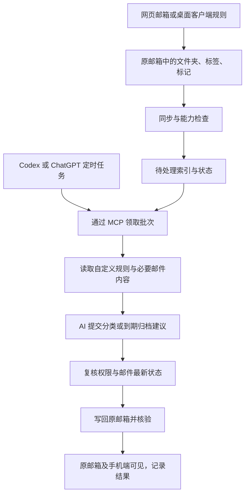

# 自定义规则、原邮箱标签与 AI/MCP 定时整理方案

日期：2026-10-22。状态：0.3.0 已实现文件夹规则与外部 AI/MCP 批次主线；原生标签及真实客户端周期验收仍待验证。基线：0.2.1。修订：按最新偏好，将外部 AI 定时任务作为主要整理入口。

2026-10-23 后续规划：用户新增“定时可选，也可外部 AI 触发”及 TG 通知需求。调度部分以[可选定时与 Telegram 优化计划](optional-scheduling-telegram-plan.md)为准；下文“不另设调度器”描述的是 0.3.0 范围，新方案尚未实施。

本方案按最新需求编制：网页邮箱和桌面客户端都会使用；整理结果必须写回原邮箱，在原邮箱和手机端可见；AI 使用 Codex/ChatGPT，通过 MCP 调用本项目。服务端继续使用 Go，不内置模型、不要求填写模型 API Key。本文取代早期方案中“以本地标签作为主要分类结果”的建议，历史文档保留。

## 1. 推荐路线

采用“原邮箱既有分类 + 可视化自定义规则 + 外部 AI 定时任务 + MCP 原邮箱执行”的组合。

你可以继续在邮箱客户端设置分类规则。本工具保持后台同步，维护文件夹、服务器标签和标记索引；同步本身不调用 AI，也不把邮件发送给模型。默认工作流中，AI 只在已挂载 MCP 的外部定时任务运行时读取授权范围邮件、作出判断并发起整理。日常对话可用于配置规则和任务范围。

各层职责：

| 层 | 职责 | 运行位置 |
| --- | --- | --- |
| 原邮箱规则 | 现有自动分类、标签和文件夹整理 | 邮箱服务商或桌面客户端 |
| 自定义规则 | 保存条件、保留天数、目标目录和保护约束，供任务查询及服务端校验 | Mail Auto / 独立 Linux 环境 |
| AI 与定时触发 | 按时通过 MCP 读取邮件、理解内容、提交整理建议 | 支持该能力的 Codex/ChatGPT 运行环境 |
| 原邮箱写入 | 范围校验、生成计划、执行、核验、审计和有条件撤销 | Mail Auto / 独立 Linux 环境 |

首版不另建一套独立定时整理循环，避免同一批邮件被两个调度器处理。规则在任务调用时匹配、预览或校验，后台同步不自行触发分类写入。若以后需要无需 AI 的固定规则后台整理，可再单独增加，并明确拆分处理范围。

MCP 服务本身不会唤醒模型；任务必须在外部客户端或其支持的运行环境实际创建。项目提供任务指引和连接状态，不把保存一段配置误报为“已创建外部定时任务”。

## 2. 当前项目的真实缺口

| 能力 | 当前情况 | 建议补充 |
| --- | --- | --- |
| 原邮箱整理 | 已有创建目录、移动、归档、回收站、恢复 | 复用现有执行、核验和撤销机制 |
| 自动同步 | 已有增量同步和后台校对 | 同步成功后供规则评估；同步不等于自动整理 |
| 自定义规则 | 没有持久化规则、优先级、模拟命中 | 规则引擎、版本和可视化编辑 |
| 周期整理 | 尚无外部 AI 周期整理闭环 | 外部任务触发；服务端批次记录、断点恢复和限量执行 |
| 原邮箱标签 | 历史 labels 表是本地数据；当前主流程使用原邮箱文件夹 | 实现可验证的服务器标签，不能用本地表冒充 |
| 规则字段 | 主要有发件人、主题、目录、未读、发信时间、大小 | 补服务器收信时间、星标、可用服务器标签及完整性状态 |
| MCP | 已有查询、计划、执行、核验、撤销、连接配置 | 规则、运行记录、批次领取及 AI 建议提交接口 |
| AI 周期协作 | 没有待处理队列和交接机制 | 有界领取、结构化提交、去重及结果追踪 |

代码依据：`internal/mail/model.go`、`internal/mail/operations.go`、`internal/mail/access.go`、`internal/mcpserver/server.go`、`internal/store/organizer.go`。当前计划主要对应单个动作；“添加服务器标签后移动”需要新增逐步骤结果。

## 3. 如何衔接你现有的客户端规则

### 3.1 优先沿用规则执行后的分类

| 现有配置 | 衔接方式 | 边界 |
| --- | --- | --- |
| 网页邮箱服务端规则 | 读取规则已经生成的目录、服务器标签、已读状态 | 标准 IMAP 通常不暴露筛选规则定义，不能承诺全部导入 |
| 桌面客户端规则 | 读取已同步到服务器的执行结果 | 本地规则可能需要客户端保持运行 |
| 桌面本地颜色/标签 | 先识别是否同步到服务器 | 仅本机保存的标签不能假定可读取或手机可见 |
| 规则导出文件 | 后续针对具体格式导入并预览字段映射 | 不支持的条件和动作逐项说明，不静默丢弃 |

第一版无需复制所有客户端规则。只有希望离开桌面客户端仍能执行的规则，才迁入本工具。暂不做泛化的规则双向同步。

### 3.2 文件夹分类和原生标签分别实现

文件夹继续作为通用方案，沿用你之前确认的选择。原生标签则按账号显示读取、添加/移除、多个标签以及客户端可见性是否已验证。IMAP 接受 keyword，并不必然表示网页端和手机端会显示成标签。

目前接入 QQ、网易、iCloud，应逐家探测和验证后开放标签动作；不能套用 Gmail 等服务商的能力。未来若需要 Gmail API 或 Microsoft Graph，应作为独立适配器评估。

不支持所需标签时，明确显示“不支持/尚未验证”，由你选择原邮箱文件夹方案。不保存仅在管理器可见的标签后声称“原邮箱已打标签”。尚未同步完整的标签字段属于未知，不能解释成“没有标签”。

### 3.3 归档后仍保留分类

文件夹分类下，邮件通常只有一个所在目录。全部移入同一个归档目录后，会失去按目录体现的分类。因此应允许配置分类归档映射，例如 `分类/账单 → 归档/账单/2026`、`分类/订阅 → 归档/订阅`。

目标目录由你选择，或在预览中确认创建，不自动大量生成。采用服务器标签的账号，只有验证移动后仍保留标签，才能承诺“保留标签并归档”。

## 4. 自定义规则设计

### 4.1 一条规则的组成

| 字段 | 内容 |
| --- | --- |
| 名称、账号与源目录 | 如“网易订阅到期归档”，限定 `分类/订阅` |
| 条件组 | 全部满足、任一满足、排除条件；支持组合 |
| 匹配字段 | 发件人/域名、主题、目录、已读、收信时长、大小；标签/星标在字段可用时开放 |
| 动作与目标 | 分类移动、原生标签增删、归档、回收站、保留原位、交给 AI |
| 保留与保护 | 保留天数、保护联系人、星标、未读等可配置排除项 |
| 优先级和冲突策略 | 先保护，再分类，再到期处理；最多一个最终移动目标 |
| 范围 | 新邮件、当前范围或显式历史回填 |
| 状态和版本 | 草稿、观察、启用、暂停；修改保存新版本 |

先支持有数据依据的结构化条件；正文语义交给外部 AI。收件人、邮件列表头和附件类型等，待实际解析、同步完成后再开放。

时间语义必须明确：

- “收信超过 30 天”需要 IMAP INTERNALDATE，不能用邮件头 Date/当前 sent_at 冒充收信时间。
- “进入该目录满 30 天”只能使用本工具首次观察时间，不能推断首次同步之前的真实移动时间。
- “已读且收信超过 30 天”不同于“读过以后满 30 天”。后者需要持续记录已读变化；历史不足时保持待判断。

### 4.2 优先提供的模板

以下为可修改示例，不会直接应用到现有邮箱：

| 规则 | 匹配 | 动作 | 时机 |
| --- | --- | --- | --- |
| 账单分类 | 指定可信发件人/域名，主题含账单或发票 | 移入 `分类/账单`；标签已验证时可另加“账单” | 新邮件稳定同步后 |
| 沿用已有标签 | 已有可读取的服务器标签“订阅” | 移到订阅目录，或仅纳入保留策略 | 同步发现变化后 |
| 订阅到期归档 | 位于 `分类/订阅`、已读、收信超过 30 天 | 移到 `归档/订阅` | 每天 02:00 |
| 账单长期归档 | 位于 `分类/账单`、收信超过 90 天 | 移到指定账单归档目录 | 每周日 |
| 推广到期回收 | 明确的推广来源/目录、已读、超过 60 天 | 移入原邮箱回收站 | 每天 02:10 |
| 内容待判断 | 常规规则未匹配且位于允许范围 | 进入 AI 待处理队列，邮件保持原位 | 外部 AI 下次领取 |

表中时间由外部 AI 定时任务触发，不另设服务端整理周期。星标、重要性等保护字段先同步或明确不支持，数据缺失时保留并说明。初期自动移入回收站由明确来源和规则承接，AI 无法判断时保持待处理。

### 4.3 避免相互覆盖和反复移动

1. 先同步，再等待可配置的稳定窗口，例如 2—5 分钟；这不保证桌面客户端规则一定已经执行。
2. 规则明确源目录，优先处理客户端已分类的目录，不默认遍历所有目录重新分类。
3. 兼容标签动作可以累积；按固定优先级选择唯一最终移动目标，终止动作停止后续移动匹配。预览列出冲突和被忽略规则。
4. 默认排除归档目标、回收站和处理终态；配置时检查目录往返和潜在循环，避免 A→B→A。
5. 执行前复核位置、标记、规则版本和权限；客户端或用户已修改则旧计划失效，重新评估。
6. 提供“保留原位/排除本次/暂停该邮件自动整理”。无法可靠关联的外部移动条目，不通过猜测 Message-ID 强行继承旧决策。

## 5. 配置与定时执行流程

### 5.1 配置规则和外部任务

你对 Codex 或 ChatGPT 说：

> 每天凌晨 2 点通过 Mail Auto MCP 整理网易邮箱：沿用现有分类，只读允许的目录，已读且收信超过 30 天的订阅邮件移入订阅归档；星标和指定联系人保留；首次运行只做预览。

配置阶段：设置账号和目录范围 → 保存结构化规则及保护条件 → 确认允许动作和数量上限 → 在支持的外部客户端实际创建 Asia/Shanghai 时区任务。配置过程不需要读取邮件正文。

首次定时运行只读取并生成预览；确认命中符合预期后，在同一外部任务中启用授权范围内的执行。后续每次由该任务唤起 AI。若客户端有额外确认要求，按其实际能力验收自动执行。

### 5.2 每次定时任务的读取和整理

例如每小时处理最多 50 封符合范围的邮件：

1. 外部运行环境按计划启动 AI，通过 MCP 领取限定范围批次。
2. 读取自定义规则，先用发件人、主题、标签和目录匹配；仅对需要语义判断的邮件读取有长度限制的正文片段。
3. 提交邮件引用、状态版本、允许分类、目标目录和理由；无法判断时保留。
4. 服务端检查预设权限范围，转为统一整理计划，复核远端后执行。
5. 返回汇总；没有外部 AI 运行、连接失败或授权失效时，邮件保持待处理。

Codex 与 ChatGPT 共同接入时，用领取租约、过期释放及幂等提交避免重复处理。AI 自报置信度不代替权限和结果核验；邮件正文中的指令不能改变规则、授权或扩大读取范围。

按 OpenAI 当前官方文档，支持相应能力的计划任务可以使用连接工具，但受账号、工作区、运行位置和写入确认约束。本地桌面任务需要机器及应用运行，符合条件的云端任务可在云端运行。应先验证目标账号的完整读写流程，再验证周期运行，不能仅凭挂载 MCP 承诺长期无人值守。

界面展示外部任务连接状态、最近领取/提交时间及实际结果；无法获取外部计划状态时显示未知。除非实际接入客户端任务管理接口，不显示“已替你创建 ChatGPT 定时任务”。

## 6. 可视化界面

| 页面 | 内容 |
| --- | --- |
| 账号能力与分类映射 | 真实目录树、归档/回收站角色、原生标签能力、客户端可见性验证、分类归档路径映射 |
| 自定义规则 | 模板、条件组、优先级、动作顺序、保护条件、观察/启停、复制、版本 |
| 规则试运行 | 范围、逐封命中理由、冲突、目标、预计变更、未知字段及跳过原因 |
| 外部任务指引 | 生成每小时/每天/每周和时区建议、客户端任务说明；实际状态以外部客户端为准 |
| 运行记录 | 触发来源、规则版本、逐项结果、失败原因、取消、核验、可撤销项 |
| AI 协作 | 待处理范围、允许分类、正文读取开关、单次/每日上限、观察/执行、外部领取时间及批次结果 |
| MCP 连接 | 保留可视化地址/开关/检测/客户端配置，补规则与批次权限及实际连接状态 |

编辑流程为“配置规则 → 外部任务首次预览 → 查看命中 → 启用授权范围内执行”。任务指引明确实际执行位置，日常使用无需手写 cron、JSON 或 SQL。

公开 HTTPS 地址仍可留空：规则、批次和执行接口可先完成隔离验证，等你反代并填入地址后再验收外部 AI 定时链路。已配置、认证成功、工具可用、定时写入成功分别展示真实状态。

## 7. 服务端与 MCP 设计

### 7.1 复用整理底座

保留预览、冻结计划、异步操作、幂等、核验和撤销。规则供匹配和校验，外部任务负责触发，AI 建议由服务端转为可验证计划；Web 与 MCP 使用同一业务服务。

新增持久化实体：规则及版本、外部运行记录、待处理条目、租约、AI 建议、逐项动作步骤及自动执行授权。首版不新增服务端周期调度实体。迁移保留账号、凭据、原邮件引用和目录映射；历史本地标签不转换为服务器标签。

原生标签同步覆盖首次全量、增量变化和历史补齐；新增收信时间、标记字段同样分批回填。字段完整性可见，未补齐不能按否定条件匹配。

### 7.2 拟增加的 MCP 工具

以下为设计，当前尚不存在，最终命名和字段以实现评审为准。

| 工具组 | 示例 | 用途 |
| --- | --- | --- |
| 能力 | `mail_capabilities` | 账号可用标签、字段、动作和限制 |
| 规则读写 | `mail_rule_list/get/upsert` | 查询、创建/修改草稿 |
| 规则验证 | `mail_rule_preview` | 有界模拟、命中和不执行原因 |
| 规则启停 | `mail_rule_set_enabled` | 在已授权范围启停 |
| 运行记录 | `mail_rule_run`、`mail_rule_run_get` | 手动/历史运行及结果查询 |
| 原生标签 | `mail_native_label_list/manage` | 按已验证适配器开放 |
| AI 交接 | `mail_ai_claim`、`mail_ai_submit_decisions` | 有界领取、幂等提交 |

表中的斜杠表示多个独立工具名。新增规则编辑、标签、AI 领取/提交权限，并与账号、目录和写入开关联动。工具读写注解如实声明，查询分页，预览限量，错误给出下一步。`mail_rule_run` 用于在已有任务批次中执行规则匹配，不在服务端另建周期。

编辑带预期版本，重试带幂等键；创建规则草稿不隐式启用写入或创建外部任务。沿用既有操作查询、取消、核验和撤销工具。

### 7.3 定时执行的可靠性

- 由外部客户端保存时区和周期；服务端保存外部任务标识、运行标识和幂等记录，重复请求不重复执行。外部客户端是否补跑按其实际能力确认。
- 同账号整理串行、分批检查点持久化，领取租约过期释放；下次任务继续未完成范围，避免大量追赶任务。
- 新邮件分类按新增及状态变化评估；超过 N 天的规则周期重扫旧候选，不能只查上次运行后的邮件。
- UIDVALIDITY 变化、外部移动或重建索引后使旧计划失效并重建基线；远端身份不确定则待核验。
- 多步动作逐步记录，例如“加标签成功、移动待核验”；IMAP 无跨步骤事务，不将部分成功显示为全成功，必需标签步骤失败则停止后续移动。
- 未知写入结果先核验，不自动重发；撤销检查当前位置和状态，明确无法撤销原因。
- 不提供永久删除；回收站必须指向原邮箱真实目录。

### 7.4 长期自动执行授权

外部任务使用客户端支持的 OAuth 授权和续期机制，不硬编码一次对话的短时 access token。服务端另保存可撤销的自动执行范围，限定账号、源目录、目标目录、动作、正文访问、数量上限和有效期。该范围不能替代有效的 MCP 客户端认证。

每次运行及写入前复核配置和版本。关闭账号写入、暂停或撤权后停止后续步骤；AI 在已授权范围内配置规则，扩大范围再确认，正常周期无需逐封确认。

外部 AI 客户端自身的确认及管理员策略仍需遵守，服务端授权不能绕过。审计记录配置者、触发来源、规则版本及实际结果。

## 8. 分阶段实施与验收

应用构建、运行、测试和部署继续在 独立 Linux 环境；Mac 仅编辑源码、文档和检查可视结果。版本号为建议拆分，以阶段出口为准。

| 阶段 | 工作 | 验收出口 |
| --- | --- | --- |
| P0 能力和数据 | 三家标签探测；补收信时间/星标/完整性；目录和归档映射 | 有证据区分支持/不支持/未验证；历史补齐可追踪；不冒充原生标签 |
| P1 规则引擎 | 条件组、版本、优先级、保护、目录动作、模拟、历史回填 | 确定性结果；未知数据跳过；循环/冲突可解释；新规则不默认处理全部历史 |
| P2 可视化闭环 | 编辑、模板、试运行、版本、启停、路径映射 | 浏览器完成完整规则；预览和执行采用同一匹配逻辑 |
| P3 MCP 与任务批次 | 能力、规则、预览、领取租约、AI 建议、限量、授权、运行记录 | AI 按范围读取和提交；重复请求不重复执行；撤权生效；未完成批次可续跑 |
| P4 外部 AI 定时闭环 | 配置指引、首次只预览、实际外部周期任务、读写和审批验证 | HTTPS 就绪后实测目标客户端；每次到时读取并整理；两客户端不重复；断线保留待处理 |
| P5 原生标签动作 | 按 P0 结果实现读写、组合动作、移动后保留核验 | 专用邮件验证网页/指定客户端可见；部分成功如实显示；不支持账号不开写入 |

建议 P0—P4 作为 0.3.0 主交付，外部 AI 定时协作纳入主线；P5 随验证结果进入 0.3.x。P0 标签可行性结论提前展示，避免最后才发现本地标签不可读取。首版不实施独立服务端整理调度器。

每批上线在 独立 Linux 环境 完成模拟 IMAP/MCP、数据库升级与恢复、桌面和手机浏览器验证。规则重点验证时间边界、保护数据缺失、冲突、到期重扫、并发变化、重复触发、未知结果和撤权。真实服务商可见性使用专用测试邮件验收，不能用协议模拟替代。

发布保留旧数据、密钥和备份。规则默认草稿/观察，升级不自动打开账号写入；历史批量整理单独预览范围。

## 9. 推荐的最终使用体验

以“挂载 MCP → 外部定时任务读取 → 按规则及必要语义判断 → MCP 原邮箱执行”为主线，同步推进原生标签探测。

1. 继续在原邮箱设置分类，或让 AI 在本工具建立等效规则。
2. 可视化选择已有分类/标签，设置保留时间和分类归档目标。
3. 挂载 MCP，在支持的外部 AI 客户端创建周期任务，首次只生成预览。
4. 查看命中后允许范围内自动执行；后续定时运行先匹配规则，需要时再读取正文判断。
5. 原邮箱和手机查看结果，管理页查看原因、暂停或恢复。

本轮只交付方案，没有创建真实规则、周期任务或修改邮件。

## 10. 官方资料

查阅日期：2026-10-22。具体账号和工作区能力仍需实测。

- [OpenAI：Scheduled tasks](https://learn.chatgpt.com/docs/automations)：运行位置、连接工具、运行条件及权限。
- [OpenAI：Scheduled tasks walkthrough](https://developers.openai.com/training/walkthroughs/scheduled-tasks)：先验证任务，再设置周期。
- [OpenAI：Custom MCP server](https://developers.openai.com/api/docs/guides/custom-mcp-server)：认证、工具读写及确认。
- [OpenAI：MCP](https://learn.chatgpt.com/docs/extend/mcp)：本地配置、远程服务和插件兼容性。

未来如需新邮件到达立即唤醒云端 AI，可另评估 [MCP Events](https://developers.openai.com/plugins/build/mcp-events)。它需要额外协议、订阅和回调支持，不作为本次周期整理依赖，也不假定现有服务已经兼容。

## 0.3.0 落地范围说明

实际工具名以 [使用指南](automation-guide.md) 为准，本方案前文工具表为设计示例。已落地结构化规则、版本、优先级、试运行、收信日期与星标补齐、管理员可撤销授权、外部批次及租约、去重、建议、受限计划执行、记录和页面任务说明。

原生标签探测后的读写适配、客户端规则导入、暂停单封邮件、实际 Codex/ChatGPT 周期任务创建及公网无人值守验收未包含在本次功能完成声明中。当前原生标签明确标识未验证，继续使用已确认的原邮箱文件夹分类。

部署环境已迁移至 独立 Linux 环境，HTTPS 已由用户配置为 mail.example.com；不沿用前文历史环境 独立 Linux 环境 或等待设置反代的假设。
